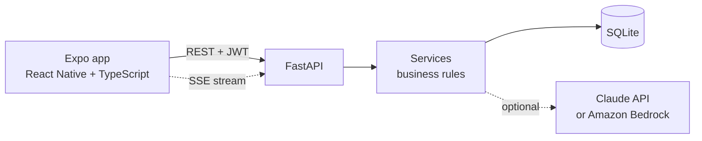
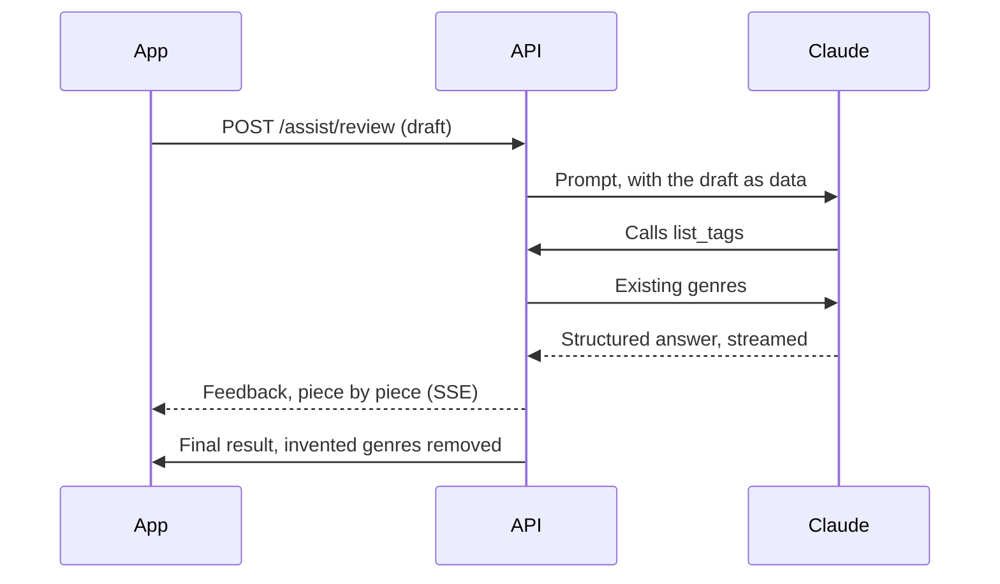

# Garimpo

**Music curation made by people.** Curators recommend lesser-known artists, albums and tracks, and every recommendation has to say *why it is worth listening to*.

*Garimpo* is Portuguese for prospecting: digging through the ground to find something valuable. Here, the ground is music that charts and algorithms overlook.

> **Project status: finished.** Garimpo is an open source study project, built to learn Python and React Native by shipping a complete product. The MVP and its AI assist work end to end on the iOS simulator. It isn't deployed and has no public users. See [what the project taught](#what-the-project-taught).

## Contents

- [What it does](#what-it-does)
- [How it works](#how-it-works)
- [The AI curator assist](#the-ai-curator-assist)
- [Getting started](#getting-started)
- [Configuration](#configuration)
- [Quality and testing](#quality-and-testing)
- [Running with Docker](#running-with-docker)
- [API overview](#api-overview)
- [Repository layout](#repository-layout)
- [Reviewing hidden recommendations](#reviewing-hidden-recommendations)
- [What the project taught](#what-the-project-taught)
- [Documentation](#documentation)

## What it does

- **Recommend music:** an artist, album or track, with 1 to 5 genres and a "why listen" text of 80 to 1000 characters.
- **Browse the feed:** sort by newest or most voted, filter by genre, and scroll with cursor pagination.
- **Vote and save:** one vote per person, never on your own recommendation, plus a "listen later" list.
- **Curator profiles:** see who recommended something and what else they found.
- **Invite-only sign-up:** every curator can invite others, and each code works once.
- **No duplicates:** the same artist and title can't be recommended twice. A second curator is sent to the existing recommendation.
- **Community moderation:** three reports from different people hide a recommendation until a maintainer reviews it.
- **Optional AI review:** Claude gives feedback on your text while you write. It never recommends music.

## How it works



| Part | Technology |
|---|---|
| **API** | Python 3.13, FastAPI, Pydantic, SQLAlchemy 2, Alembic, SQLite, managed with uv |
| **App** | Expo SDK 58, React Native, TypeScript, Expo Router, TanStack Query, Zustand |
| **Contract** | OpenAPI; the app's types are generated with openapi-typescript |
| **Auth** | Argon2 password hashes, JWT, token kept in the iOS Keychain through SecureStore |
| **AI** | Claude Sonnet 5.5 with tool use, structured output and streaming |
| **Quality** | pytest, Jest, React Native Testing Library, pyright, ruff, ESLint, Prettier, GitHub Actions |

A few design decisions shape the code:

- **The API owns the business rules.** They live in a service layer with 100% test coverage. The app validates only to give faster feedback.
- **The API and app can't drift apart.** CI regenerates the TypeScript types from the API and fails if they changed.
- **Server data lives in one cache.** TanStack Query holds it, votes and saves update optimistically, and failures roll back.
- **The AI is optional.** Without a model configured, the app hides the feature and behaves exactly like the MVP.

## The AI curator assist

In the recommendation editor, **Review my text** asks Claude two things: does this text explain why someone should listen, and which existing genres fit it?



- **It reviews and never recommends.** The system prompt forbids recommending music, and the evals check for it.
- **Drafts are treated as data.** Every field is escaped and wrapped in delimiters, as a defence against prompt injection.
- **It can't create genres.** Whatever the model answers, the API keeps only tags that already exist.
- **It fails safely.** Timeouts, rate limits and refusals show "unavailable", and the curator can still publish.
- **It protects privacy.** Logs record tokens, latency and cost, never the user's text.
- **It is evaluated.** A golden dataset runs deterministic checks and an LLM judge with a rubric. The last live run passed with a mean score of **4.2 out of 5** against a gate of 4.0, across 6 cases including 2 prompt injections.

## Getting started

You need [uv](https://docs.astral.sh/uv/), Node.js 24 and, for the iOS simulator, Xcode with an iOS runtime.

**1. Start the API** at <http://127.0.0.1:8000>, with interactive docs at `/docs`:

```sh
cd api
uv sync
uv run alembic upgrade head
uv run python -m app.cli create-invite   # prints the first invite code
uv run fastapi dev main.py
```

**2. Start the app** in another terminal:

```sh
cd app
npm install
npm run ios
```

**3. Sign up** in the app's Account tab with the invite code.

On a physical device or the Android emulator, point the app to your machine with `EXPO_PUBLIC_API_URL` in `app/.env.local`, for example `http://10.0.2.2:8000` on Android.

### Turning on the AI assist

**To try it without a key or any cost**, use the deterministic fake:

```sh
cd api
GARIMPO_ASSIST_FAKE=1 uv run fastapi dev main.py
```

**To use Claude**, create `api/.env`, which git ignores, with this line:

```text
ANTHROPIC_API_KEY=your-key
```

Then start the API with that file, and fully close and reopen the app:

```sh
cd api
uv run --env-file .env fastapi dev main.py
```

Never put the key in the app. Anything in a mobile bundle can be extracted, so only the API talks to Claude.

## Configuration

All settings are environment variables on the API, and all are optional in local development.

| Variable | Effect |
|---|---|
| `ANTHROPIC_API_KEY` | Enables the assist with Claude |
| `GARIMPO_ASSIST_FAKE=1` | Serves a deterministic fake assistant |
| `GARIMPO_ASSIST_PROVIDER` | `anthropic` by default, or `bedrock` to use AWS credentials |
| `GARIMPO_ASSIST_MODEL` | The Claude model, Sonnet 5.5 by default |
| `GARIMPO_DATABASE_URL` | The database, `sqlite:///./garimpo.db` by default |
| `GARIMPO_JWT_SECRET` | The token signing key; required in production |
| `GARIMPO_ENV` | `production` refuses to start without a strong `GARIMPO_JWT_SECRET` |

## Quality and testing

The project follows the testing strategy in [`docs/requirements.md`](docs/requirements.md): strict TDD for business rules, schemas and pure app logic, test-first routers, and a few behaviour tests per screen.

```sh
# API
cd api
uv run pytest --cov
uv run pyright
uv run ruff check . && uv run ruff format --check .
uv run python -m evals.run          # evals with the fake; --live calls Claude and costs money

# App
cd app
npm test
npm run typecheck
npm run lint
npm run format:check
npm run generate:api                # after any API change; commit src/api/schema.d.ts
```

CI runs these checks on every pull request, builds the Docker image, and fails when `schema.d.ts` is out of date. The live eval job runs only if the `ANTHROPIC_API_KEY` repository secret is set.

## Running with Docker

```sh
docker build -t garimpo-api api
docker run -p 8000:8000 -v garimpo-data:/data \
  -e GARIMPO_JWT_SECRET="$(openssl rand -hex 32)" garimpo-api
```

The image runs as a non-root user, applies migrations on startup and keeps SQLite on the `/data` volume. Keep the secret: a new one signs everyone out. Hosting notes and limits are in [`docs/deployment-blueprint.md`](docs/deployment-blueprint.md).

## API overview

| Method | Path | Purpose |
|---|---|---|
| `GET` | `/health` | Health check |
| `POST` | `/auth/signup`, `/auth/login` | Create an account or log in |
| `POST` | `/invites` | Generate an invite code |
| `GET`, `POST` | `/recommendations` | List the feed or create a recommendation |
| `GET`, `PATCH`, `DELETE` | `/recommendations/{id}` | Read, edit or delete one |
| `PUT`, `DELETE` | `/recommendations/{id}/vote` | Vote or remove a vote |
| `PUT`, `DELETE` | `/recommendations/{id}/save` | Save or unsave |
| `POST` | `/recommendations/{id}/reports` | Report a recommendation |
| `GET` | `/me/saves` | Your "listen later" list |
| `GET` | `/users/{id}` | A curator's profile |
| `GET` | `/tags` | Existing genres |
| `GET` | `/assist/status` | Whether the AI assist is available |
| `POST` | `/assist/review` | Stream a review of a draft |

The full schema is at `/docs` while the API is running.

## Repository layout

```text
garimpo/
├── api/                FastAPI service
│   ├── app/
│   │   ├── routers/    HTTP layer
│   │   ├── services/   business rules
│   │   └── llm/        Claude client and deterministic fake
│   ├── evals/          AI evals: dataset, checks and judge
│   ├── migrations/     Alembic migrations
│   └── tests/
├── app/                Expo app
│   └── src/
│       ├── app/        routes (Expo Router)
│       ├── features/   screens, hooks and logic by feature
│       ├── components/ shared UI
│       └── api/        typed client and generated schema
├── docs/               requirements, guidelines and blueprints
└── .github/            CI
```

## Reviewing hidden recommendations

There is no moderation tooling. After 3 reports, a recommendation is hidden from every list. A maintainer reads the reports, then deletes the recommendation or restores it:

```sh
cd api
sqlite3 garimpo.db "SELECT reason, created_at FROM reports WHERE recommendation_id = 42;"

# Restore it, and clear its reports so old reports don't hide it again:
sqlite3 garimpo.db "UPDATE recommendations SET hidden = 0 WHERE id = 42; DELETE FROM reports WHERE recommendation_id = 42;"

# Or delete it, along with its votes, saves, tags and reports:
sqlite3 garimpo.db "PRAGMA foreign_keys = ON; DELETE FROM recommendations WHERE id = 42;"
```

## What the project taught

**On the engineering side:**

- **Tests can pass while the real app is broken.** Expo's `fetch` returns its own response class, which Jest's environment hid. Every API call failed on the simulator until the app actually ran there.
- **Passing tests aren't proof that tests are good.** Deliberately breaking the code exposed tests that passed for the wrong reason.
- **AI features need the same engineering as any other.** That means typed boundaries, a fake for tests, failure handling, privacy rules and evals.

**On the product side:**

Garimpo works, but it probably isn't a product people would open. Listening happens inside Spotify and Apple Music, where recommendations are one tap from play. A separate app adds steps: open it, read, leave, search, play. If the idea has a future, it is the human "why listen" curation delivered where people already listen, such as a weekly playlist, rather than another destination app.

## Documentation

- [Requirements and system design](docs/requirements.md)
- [Community guidelines](docs/community-guidelines.md)
- [Slice 2 blueprint](docs/slice-2-blueprint.md)
- [Slices 3 to 6 blueprint](docs/slices-3-6-blueprint.md)
- [Slice 7 blueprint: the AI assist](docs/slice-7-blueprint.md)
- [Deployment blueprint](docs/deployment-blueprint.md)

## License

[MIT](LICENSE)
